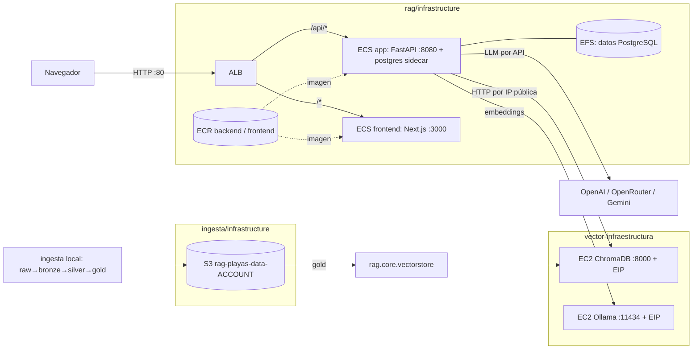

# Arquitectura A4 (base greenfield)

Describe lo declarado en `main`. Que estos recursos existan en una cuenta solo se sabe tras desplegarlos.

## Diagrama de componentes

## Componentes

| Componente | Stack / código | Responsabilidad |
|---|---|---|
| Bucket S3 | `ingesta/infrastructure/s3.tf` | Capas raw/bronze/silver/gold; versionado y SSE |
| Pipeline de ingesta | `ingesta/ingest/` | Conversión, seccionado y enriquecimiento hacia Gold |
| EC2 ChromaDB | `vector-infraestructura/chromadb.tf`, `scripts/ec2_chroma_db.sh` | Índice vectorial, colección `rag_playas` |
| EC2 Ollama | `vector-infraestructura/ollama.tf`, `scripts/ec2_ollama_embeddings.sh` | Embeddings `embeddinggemma` |
| ALB | `rag/infrastructure/alb.tf` | Entrada HTTP y enrutado `/api/*` frente a `/*` |
| ECS app | `rag/infrastructure/ecs.tf` | API, agente LangGraph y autenticación JWT+SQL; PostgreSQL como sidecar |
| ECS frontend | `rag/infrastructure/ecs.tf` | Interfaz Next.js |
| EFS | `rag/infrastructure/efs.tf` | Persistencia de PostgreSQL |
| ECR | `rag/infrastructure/ecr.tf` | Imágenes de backend y frontend |
| IAM | `rag/infrastructure/iam.tf` | Solo lectura de `LabRole` (no crea roles) |

## Relaciones

- **Configuración entre stacks:** `vector-infraestructura/scripts/deploy.sh` pasa las IPs de Chroma y Ollama al stack rag reescribiendo `rag/infrastructure/terraform.tfvars`.
- **Bucket de datos:** el stack rag lo recibe en `var.s3_bucket_name`, de forma manual.
- **Imágenes:** el frontend lleva la URL del ALB incorporada en el build (`rag/infrastructure/scripts/push_images.sh`).
- **Red:** todo está en la VPC por defecto. ECS llega a Chroma y Ollama por sus EIP públicas.

## Pendiente de validación

| Elemento | Qué falta verificar |
|---|---|
| ECS Exec | Permisos `ssmmessages` de LabRole; lo usan el seed y `export_postgres.sh` |
| EFS con autorización IAM | Permisos `ClientMount` / `ClientWrite` de LabRole |
| Comunicación privada ECS → EC2 | Viabilidad dentro de la VPC por defecto (no implementada) |
| Backend remoto del state | Diseño y bucket (sin decidir) |
| Reranker de Ollama (`ollama_reranker_model`) | No se descarga en el user-data |
| Coste por sesión | No medido en una cuenta real |
