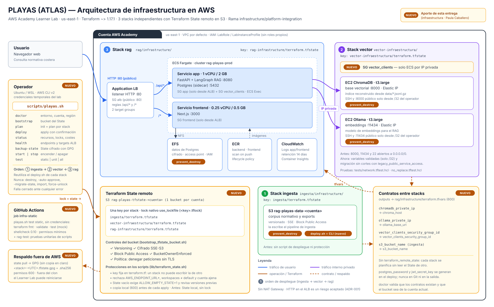
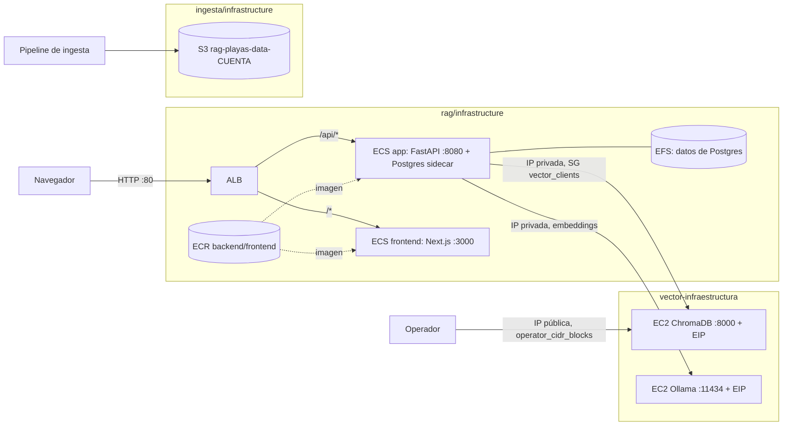

# Arquitectura de infraestructura

Describe lo declarado en el repositorio. Que los recursos existan en una
cuenta solo se sabe tras desplegarlos (`scripts/playas.sh status`).

El porqué de cada decisión está en los [ADR](adr/README.md); qué control
verifica cada prueba, en [CONTROLS.md](CONTROLS.md).

## Decisión de base ([ADR-001](adr/001-despliegue-por-cuenta.md), 2026-11-01)

- Cada integrante despliega en **su propia** cuenta de Learner Lab, como
  despliegue nuevo: no se recuperan ni importan recursos ni state de
  despliegues anteriores (sus cuentas no son accesibles).
- Se conservan los tres stacks existentes; no se mueven archivos Terraform ni
  states (`CLAUDE.md`).
- HTTP en el ALB es un riesgo aceptado.
- Consecuencia: el índice de ChromaDB se reconstruye desde `data/*.jsonl.gz`
  y los usuarios de `data/seed_users.sql` se siembran en cada despliegue.

## Stacks

| Stack | Directorio | Key del state | Recursos | Despliegue |
|---|---|---|---|---|
| ingesta | `ingesta/infrastructure/` | `ingesta/terraform.tfstate` | Bucket S3 `rag-playas-data-<cuenta>` (versionado, SSE) | `scripts/deploy.sh` |
| vector | `vector-infraestructura/` | `vector-infraestructura/terraform.tfstate` | EC2 ChromaDB y Ollama, EIP, SG (incluido `vector_clients`) | `scripts/deploy.sh` |
| rag | `rag/infrastructure/` | `rag-infrastructure/terraform.tfstate` | ECS Fargate (app + sidecar Postgres, frontend), ALB, ECR, EFS, logs | `scripts/deploy.sh` |

## Orden de despliegue y contratos

`ingesta` y `vector` son independientes entre sí; `rag` consume a ambos.
`scripts/playas.sh deploy all` y `plan all` siguen siempre
**ingesta → vector → rag** y se detienen en el primer fallo.

| Productor (output) | Consumidor (`rag/infrastructure/terraform.tfvars`) | Quién lo escribe |
|---|---|---|
| vector `chromadb_private_ip` | `chroma_host` | `vector-infraestructura/scripts/deploy.sh` |
| vector `ollama_private_ip` | `ollama_base_url` (`http://<ip>:11434`) | idem |
| vector `vector_clients_security_group_id` | `vector_clients_security_group_id` | idem |
| ingesta `s3_bucket_name` | `s3_bucket_name` | manual; `deploy ingesta` muestra el valor |
| — | `postgres_password`, `jwt_secret_key` | generados por el deploy de vector si son placeholders |

`scripts/playas.sh doctor` comprueba que esos valores existen y que
`s3_bucket_name` es el bucket de ingesta de la cuenta actual. Los contratos se
pasan por tfvars (600, no versionado) y no por `terraform_remote_state`: así
cada stack se planifica sin leer el state de otro.

## Terraform State

- Backend S3 en los tres stacks (`terraform.tf`), región `us-east-1`,
  `encrypt = true` y bloqueo nativo `use_lockfile = true` (archivo
  `<key>.tflock`; requiere Terraform ≥ 1.10, el repo fija `~> 1.17.1`).
- Un bucket por cuenta, `rag-playas-tfstate-<cuenta>`, creado por
  `scripts/playas.sh bootstrap`: BucketOwnerEnforced, Block Public Access,
  versionado, SSE-S3 y política que deniega peticiones sin TLS.
- `backend.hcl` (no versionado) solo contiene `bucket`; la key es fija en
  cada `terraform.tf`, de modo que ningún stack puede escribir la de otro.
- Los scripts rechazan endpoints alternativos (`AWS_ENDPOINT_URL*`), workspaces
  distintos de `default` y states vacíos no confirmados (ver README raíz,
  "Comportamiento de los scripts con backend S3").
- Respaldos: copia en claro (600) en `~/tfstate-backups` antes de cada apply
  y copia cifrada con GPG fuera de AWS con `scripts/playas.sh backup-state`.

## Red y seguridad

- Todo en la VPC por defecto. ECS llega a ChromaDB/Ollama por IP privada
  desde el SG `vector_clients`; el acceso público a 8000/11434 queda limitado
  a `operator_cidr_blocks` (`legacy_public_service_access = false` tras la
  migración).
- Sin roles IAM propios: se usa `LabRole` (ECS) y `LabInstanceProfile` (bastion).
- Secretos solo en tfvars y `.env` locales (600); nunca en Git ni en la salida
  de los scripts.

## Limitaciones conocidas

- **Secretos en argumentos de `sed` (S7).** `postgres_password`, `jwt_secret_key` y, en el
  bastion, `OPENAI_API_KEY` se escriben en los tfvars con `sed -i`
  (función `update_tfvars` de `vector-infraestructura/scripts/deploy.sh` y el `sed -i` de `openai_api_key` en `scripts/deploy_bastion_ec2.sh`).
  Durante unos instantes son visibles en `/proc/<pid>/cmdline` en máquinas multiusuario.
  No se imprimen. Pendiente reescribirlo.
- **Prefijo de nombres fijo (A11).** `rag-playas-prod` está fijo en la CLI y los scripts
  (`TF_DEFAULT_PROJECT` y `TF_DEFAULT_ENVIRONMENT` en `scripts/lib/terraform_state.sh`). Cambiar `project`/`environment` en tfvars hace que
  `status`/`health`/`start`/`stop` busquen nombres que no existen: no cambiarlos.
- **Deriva en vector (H1).** Los recursos de vector (SG, EIP) que existan fuera del state solo
  se detectan con state vacío (`ALLOW_EMPTY_STATE`). Con state no vacío no hay una comprobación
  de deriva equivalente a `check_sg_drift` de rag
  (`check_sg_drift` en `rag/infrastructure/scripts/deploy.sh`). `status` (`status_vector_eips`,
  `scripts/playas.sh`) imprime `EIP asignadas: N`, avisa si N no es 2 y lista por
  `AllocationId` y `Name` las EIP sin `AssociationId`, sin imprimir IPs; si la consulta falla
  imprime `EIP asignadas: ?` y continúa. No detecta otros recursos de vector fuera del state.

- **`legacy_public_service_access` en `doctor` (R6).** `doctor` lo determina solo desde
  `vector-infraestructura/terraform.tfvars` e ignora `TF_VAR_legacy_public_service_access`,
  que sí aceptan `scripts/playas.sh` (comprobación de existencia del tfvars) y
  `vector-infraestructura/scripts/deploy.sh`. Si se define solo por variable de entorno y
  `vector_clients_security_group_id` está vacío, `doctor` avisa en lugar de fallar.
  Recomendación: definirlo en el tfvars.

## Pendiente de validar en una cuenta real

| Elemento | Qué falta |
|---|---|
| `s3:ListBucketVersions` en LabRole/voclabs | Lo comprueba `doctor`; sin él, `ALLOW_EMPTY_STATE=1` se detiene |
| ECS Exec (`ssmmessages`) | Lo usan la siembra de usuarios y `export_postgres.sh` |
| EFS con autorización IAM | `ClientMount`/`ClientWrite` de LabRole |
| AWS Backup del EFS | Desactivado por defecto (`enable_efs_backup`) |
| Coste por sesión | No medido |
